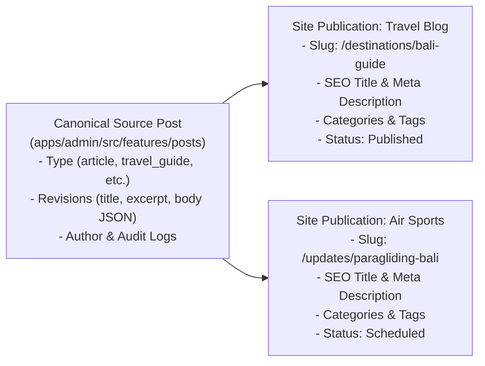

# Content Workspace & Editorial Workflow

## 1. Canonical Source Post vs Site Publication Separation

The core architecture separates **canonical editorial content** from **site-specific publications**:

- **Canonical Post (`PostItem`)**: Represents the editorial asset. Stores revision history, rich text AST (Tiptap document JSON), word count, and canonical locale.
- **Site Publication (`PostPublicationItem`)**: Scoped to an individual website tenant. Governs the public URL slug, SEO metadata, category/tag bindings, scheduled release date, and publication lifecycle status.

---

## 2. Posts Workspace (`/posts`)

The main editorial view displays content across all sites (or filtered by active site context):

- **Search & Filtering**: Real-time title search, content type filter (`article`, `travel_guide`, `air_sports_update`, `event_update`, `news`, `live_update`), and status filter (`draft`, `in_review`, `scheduled`, `published`, `archived`).
- **Publication Badges**: High-contrast status pills indicating release state on attached sites.
- **Contextual Action Menu**:
  - Edit content (`/posts/[postId]/edit`).
  - Submit draft for editorial review (`submitForReview`).
  - Launch publishing modal (immediate release, future scheduling, or unpublishing).
  - Soft deletion with confirmation.

---

## 3. Rich Text Editing Experience (`PostForm`)

The content editor (`apps/admin/src/features/posts/components/PostForm.tsx`) provides a rich composition environment:

1. **Tiptap Rich Text Editor**:
   - Headless Tiptap engine configured with `@multi-site-cms/ui` design tokens.
   - Slash (`/`) command menu for block insertion: Headings, Callout boxes, Travel Destination info cards, Event timeline items, Tables, Code blocks, and Media.
   - Floating bubble menu for rapid text formatting (Bold, Italic, Strikethrough, Underline, Link, Alignment).

2. **Autosave Engine (`useAutosave`)**:
   - Debounced automatic synchronization (2500ms) with the backend.
   - Optimistic concurrency control (OCC) using `expectedRevisionNumber`. Prevents overwriting changes made by concurrent editors.
   - Online/Offline status indicator (`saving`, `saved`, `unsaved`, `offline`, `conflict`).

3. **Session Draft Recovery (`useDraftRecovery`)**:
   - Automatically buffers unsaved edits in browser `sessionStorage`.
   - On browser refresh or accidental tab closure, surfaces an alert banner offering 1-click draft restoration.

4. **Media Asset Integration (`MediaLibraryModal`)**:
   - Seamless media modal for selecting existing destination photos or uploading new images directly from the editor toolbar or featured image picker.
