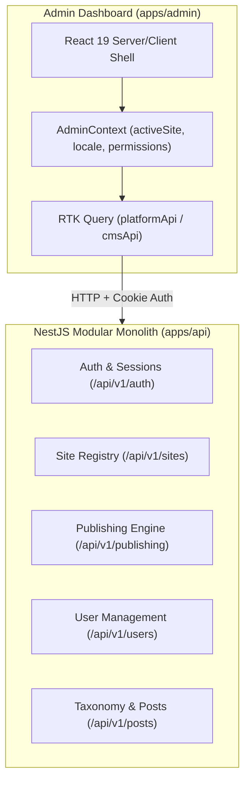

# Admin Dashboard Architecture

## 1. Overview

The administrative dashboard (`apps/admin`) is the unified control center for the `multi-site-cms` platform. It serves both the platform owner (**Super Admin**) managing multiple public websites (e.g., _Travel Blog_, _Air Sports_, and future tenants) and client administrators (**Site Admins**) managing only their explicitly assigned websites.

The dashboard is engineered as an enterprise-grade Next.js application built with strict security boundaries, responsive layout primitives, and seamless real-time telemetry.

---

## 2. Technology Stack & Key Libraries

| Component              | Technology                                     | Version  | Purpose                                                 |
| :--------------------- | :--------------------------------------------- | :------- | :------------------------------------------------------ |
| **Framework**          | Next.js (App Router, Turbopack)                | `16.4.3` | Server/Client components, SSR, static optimization      |
| **Runtime UI**         | React                                          | `19.3.1` | Modern concurrent rendering, hooks                      |
| **Styling**            | Tailwind CSS v4 & `@multi-site-cms/ui`         | `4.3.3`  | Design tokens, responsive utilities                     |
| **State Management**   | Redux Toolkit & RTK Query                      | `2.13.0` | Cache invalidation, automated polling, normalized state |
| **Icons**              | Lucide React                                   | `1.66.0` | Accessible vector iconography                           |
| **Rich Text Editor**   | Tiptap (Headless & React)                      | `3.32.2` | Structured document editing, custom extensions          |
| **Forms & Validation** | React Hook Form & `@multi-site-cms/validation` | `7.91.0` | Shared Zod schemas, form state management               |

---

## 3. Application Shell Primitives

The visual experience is unified under a responsive shell component (`ShellLayout`):

1. **`AuthGuard` (`apps/admin/src/components/shell/AuthGuard.tsx`)**:
   - Inspects the authenticated user session via `useGetMeQuery`.
   - Redirects unauthenticated visitors to `/login?returnUrl=...`.
   - Evaluates RBAC permissions (`requiredPermission`) and platform privileges (`superAdminOnly`).
   - Renders 403 Forbidden redirects or fallbacks when access is denied.

2. **`SiteSwitcher` (`apps/admin/src/components/shell/SiteSwitcher.tsx`)**:
   - Allows Super Admins to toggle between **All Sites (Platform View)** and specific sites.
   - Restricts Site Admins strictly to their assigned sites.
   - Detects and prompts if unsaved form changes exist before switching context.

3. **`Sidebar` (`apps/admin/src/components/shell/Sidebar.tsx`)**:
   - Collapsible responsive drawer for mobile and fixed sidebar on desktop.
   - Conditionally surfaces platform-wide routes (**Site Registry**, **User Management**) based on user privileges.
   - Highlights active routes and current site indicators.

4. **`Header` (`apps/admin/src/components/shell/Header.tsx`)**:
   - Sticky top bar with mobile menu toggle, active site dropdown, bilingual language toggle (`EN` / `বাংলা`), and user profile menu.

---

## 4. Central State & Context (`AdminContext`)

All administrative screens consume the centralized context provided by `AdminProvider` (`apps/admin/src/lib/admin-context.tsx`):

- **`activeSiteId` / `activeSite`**: Currently selected tenant website. Defaults to the first permitted site for client admins, or `null` (Platform Overview) for Super Admins.
- **`locale` / `setLocale`**: Bilingual interface toggle (`'en'` vs `'bn'`) persisted across sessions via `localStorage`.
- **`t`**: Callable and object-accessible bilingual dictionary supporting typed autocomplete.
- **`user` / `isSuperAdmin`**: Session identity and role status.
- **`hasUnsavedChanges` / `setHasUnsavedChanges`**: Dirty form tracking to prevent accidental navigation loss.
- **`can(permission, siteId)`**: Client-side helper for UI element gating.

---

## 5. Phase 08 Telemetry Integration

The admin dashboard integrates directly with the Phase 08 publishing engine background services:

- **Publishing Health Telemetry (`/api/v1/publishing/health`)**:
  - Polled at regular intervals on the overview dashboard.
  - Displays background scheduled worker operational heartbeat.
  - Monitors the transactional outbox dispatcher status.
  - Tracks due queue depth and dead-letter backlog metrics.
