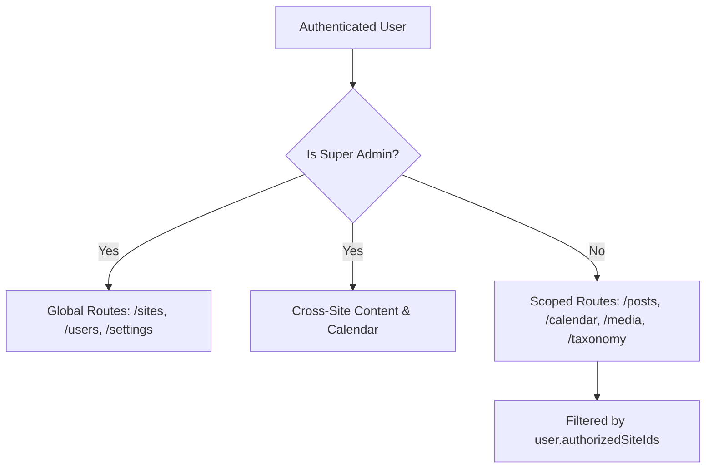

# Navigation & Role-Aware Authorization

## 1. Persona Model

The `multi-site-cms` platform models two primary classes of administrative users:

| Attribute                | Platform Super Admin                                       | Client Site Admin                         |
| :----------------------- | :--------------------------------------------------------- | :---------------------------------------- |
| **Role Scope**           | `scopeType: 'platform'`                                    | `scopeType: 'site'`                       |
| **Site Scope**           | Cross-site, all current and future sites                   | Bound to explicit `siteId` assignments    |
| **Active Site Selector** | Can choose `All Sites (Platform View)` or any site         | Restricted strictly to assigned sites     |
| **Site Registry**        | Create, configure, verify domains, delete sites            | Read-only or hidden entirely              |
| **User Management**      | Create users, assign platform/site roles                   | Cannot view or manage other accounts      |
| **Publishing Engine**    | Full release authority, cancel/reschedule across all sites | Release authority only for assigned sites |

---

## 2. Navigation Architecture

Navigation routes dynamically adapt based on the user's role and active site context:

### Route Table

| Path                   | Required Permission | Visibility Gating | Description                                |
| :--------------------- | :------------------ | :---------------- | :----------------------------------------- |
| `/`                    | Authenticated       | All Users         | Dashboard overview with metrics and health |
| `/posts`               | `post:read`         | All Users         | Editorial content workspace                |
| `/posts/new`           | `post:create`       | All Users         | Canonical post creation                    |
| `/posts/[postId]/edit` | `post:update`       | All Users         | Rich text editor, publications, revisions  |
| `/calendar`            | `publication:read`  | All Users         | Timezone-aware publishing calendar         |
| `/media`               | `media:read`        | All Users         | Central media asset library                |
| `/taxonomy`            | `taxonomy:read`     | All Users         | Site-scoped categories and tags            |
| `/sites`               | `site:read`         | Super Admin Only  | Multi-site registry and domain manager     |
| `/sites/new`           | `site:manage`       | Super Admin Only  | Provisioning new website tenant            |
| `/sites/[siteId]`      | `site:manage`       | Super Admin Only  | Site settings, DNS challenge verification  |
| `/users`               | `user:read`         | Super Admin Only  | Administrative user registry               |
| `/users/new`           | `user:manage`       | Super Admin Only  | Provision new administrator                |
| `/users/[userId]`      | `user:read`         | Super Admin Only  | Account status and role assignment         |

---

## 3. Client vs Server Authorization Policy

### Backend is the Single Source of Truth

Client-side UI gating (hiding buttons, disabling inputs, route guards) is implemented strictly for **user experience**, never as security enforcement.

Every API call made by `apps/admin` sends standard session cookies (`credentials: 'include'`). The NestJS API verifies:

1. Valid session and CSRF token.
2. User account active status (non-suspended, non-locked).
3. Explicit permission check via `@RequirePermissions(...)`.
4. Site-scoping check (`siteId` in URL or body matches `user.authorizedSiteIds` unless caller is a Super Admin).

### Unauthorized Handling (`/unauthorized`)

If a user directly enters a URL they lack privileges to access, `AuthGuard` halts rendering and redirects the user to `/unauthorized` (HTTP 403 screen), providing a direct link back to permitted operations.

---

## 4. Unsaved Changes Interception

To protect editorial staff against accidental data loss when switching sites or navigating away:

1. `AdminContext` maintains a `hasUnsavedChanges` boolean flag.
2. Forms (such as `PostForm` and `RichTextEditor`) set `hasUnsavedChanges = true` on dirty input.
3. When the user attempts to switch sites via `SiteSwitcher`, a native confirmation dialog triggers (`nav.unsavedWarning`).
4. If cancelled, site switching is aborted and the current form state remains intact.
