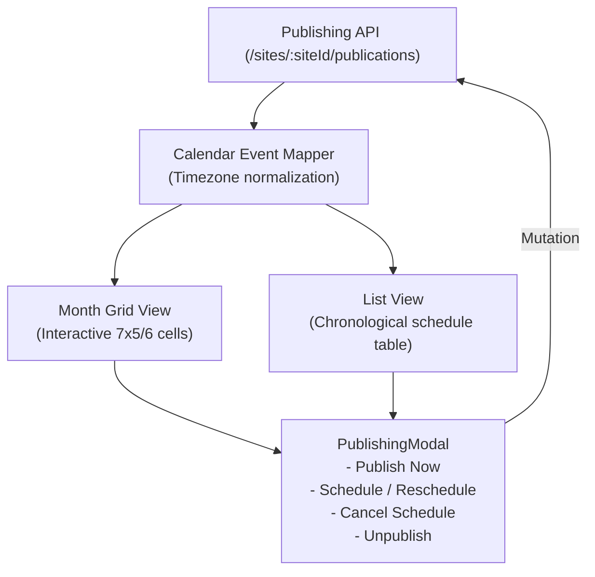

# Publishing Calendar & Scheduling UI

## 1. Overview

The Publishing Calendar (`apps/admin/src/app/calendar/page.tsx`) provides editors and administrators with a visual roadmap of scheduled and past releases across their managed websites.

---

## 2. Views & Navigation

### 1. Month Grid View

- Displays standard 7-day week columns with day numbers and current day highlight.
- Visual event chips color-coded by lifecycle state:
  - **Scheduled (Blue)**: Shows publication target time.
  - **Published (Green)**: Past successful releases.
  - **In Review (Purple)**: Editorial candidates awaiting release approval.
- Clickable event chips open direct scheduling actions.

### 2. Chronological List View

- Linear tabular schedule grouped by target release date.
- Shows post title, site badge, target time, content type, and current status.
- Quick action buttons to reschedule or cancel release.

---

## 3. Timezone Normalization

A common failure mode in multi-tenant publishing platforms is timezone ambiguity (e.g., an editor in London scheduling an article for a site based in New York or Dhaka).

The admin calendar enforces explicit timezone handling:

1. Every site maintains an explicit `timezone` configuration (e.g. `Asia/Dhaka`, `America/New_York`, `UTC`).
2. The calendar header prominently displays the active timezone: `Site Timezone: Asia/Dhaka`.
3. Date inputs and scheduled release labels use `formatDateTime(..., locale, timezone)` to render times in the site's target publication timezone, avoiding local machine bias.

---

## 4. The Publishing Modal (`PublishingModal`)

The `PublishingModal` (`apps/admin/src/features/posts/components/PublishingModal.tsx`) handles all publishing transitions:

| Action               | Prerequisites      | Backend Endpoint                                       | Behavior                                                                                     |
| :------------------- | :----------------- | :----------------------------------------------------- | :------------------------------------------------------------------------------------------- |
| **`publish`**        | Draft or In Review | `POST /sites/:siteId/publications/:id/publish`         | Transitions status to `published`, sets `publishedAt`, immediately purges public edge cache. |
| **`schedule`**       | Draft or In Review | `POST /sites/:siteId/publications/:id/schedule`        | Validates target time is $\ge 5$ seconds in the future. Transitions status to `scheduled`.   |
| **`reschedule`**     | Scheduled          | `POST /sites/:siteId/publications/:id/reschedule`      | Updates scheduled timestamp and updates pending background job.                              |
| **`cancelSchedule`** | Scheduled          | `POST /sites/:siteId/publications/:id/cancel-schedule` | Cancels queue job and returns publication to `draft` status.                                 |
| **`unpublish`**      | Published          | `POST /sites/:siteId/publications/:id/unpublish`       | Evicts content from public website, returns publication to `draft`, invalidates edge cache.  |
| **`archive`**        | Published or Draft | `POST /sites/:siteId/publications/:id/archive`         | Preserves slug reservation and analytics while taking content offline.                       |
| **`restore`**        | Archived           | `POST /sites/:siteId/publications/:id/restore`         | Returns archived publication to `draft` for re-editing.                                      |
