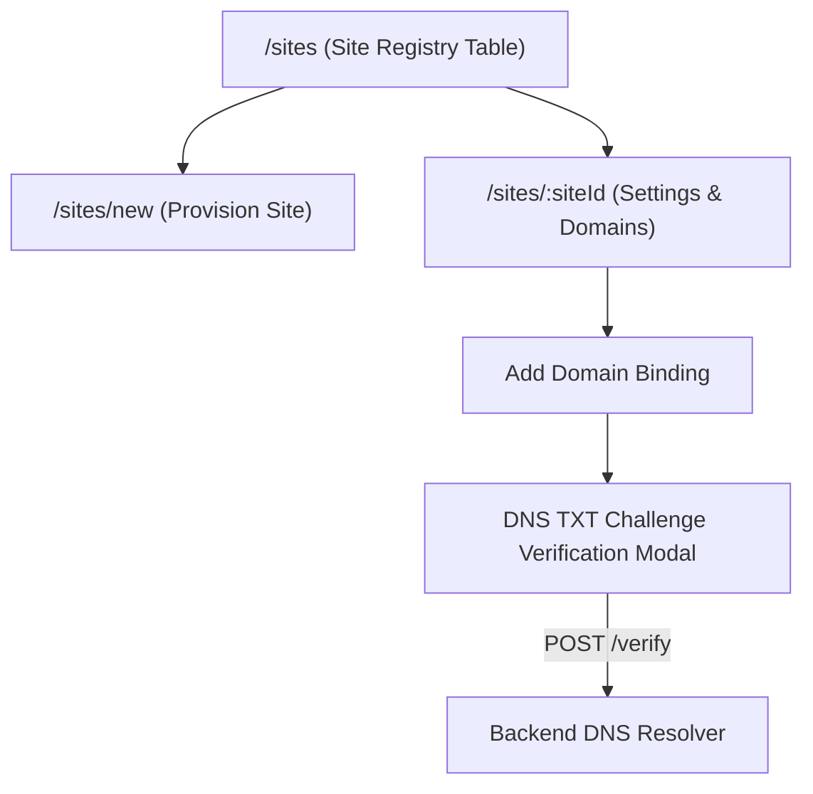

# Site Registry & Domain Management UI

## 1. Overview

The Site Management system (`/sites`) is exclusive to the **Platform Super Admin**. It allows the creation, configuration, domain binding, and DNS verification of independent websites managed by the multi-site CMS.

---

## 2. Site Provisioning (`/sites/new`)

Creating a new website requires:

- **Site Name**: Human-readable name (e.g. `Travel Blog`, `Air Sports Portal`).
- **Site Key**: Unique, lowercase slug identifier (e.g. `travel-blog`, `air-sports`). Automatically slugified from the name.
- **Default Locale**: Primary content language (`en`, `bn`, `es`, `fr`).
- **Timezone**: Canonical publishing timezone (`UTC`, `Asia/Dhaka`, `America/New_York`, etc.).

---

## 3. Domain Management & DNS Verification (`/sites/[siteId]`)

Each site can have one primary domain and multiple domain aliases.

### Domain Operations:

1. **Add Domain**: Enter hostname (e.g., `news.airsports.org`). Backend normalizes and validates hostname syntax and uniqueness.
2. **Make Primary**: Sets the selected domain as the canonical host for the website.
3. **Delete Domain**: Removes alias bindings. Primary domains cannot be deleted while active.

### DNS TXT Record Verification Workflow:

1. Clicking **View DNS Challenge** triggers `useGetVerificationChallengeQuery`.
2. The modal displays:
   - **Record Type**: `TXT`
   - **Host / Name**: `_cms-challenge.<hostname>`
   - **Value**: Secure cryptographic verification token (e.g. `cms-verification=...`)
3. The Super Admin copies the value and configures it in their DNS provider.
4. Clicking **Verify Domain Now** calls `POST /sites/:siteId/domains/:domainId/verify`.
5. Upon successful DNS lookup, the domain status changes to **Verified**.
