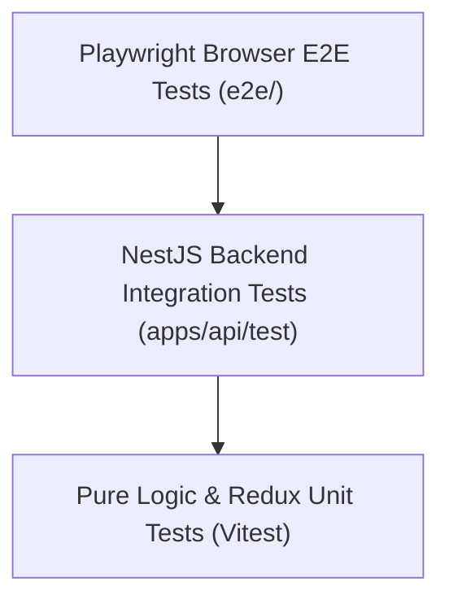

# Admin Dashboard Testing Strategy & Verification

## 1. Multi-Tier Testing Pyramid

The admin dashboard relies on a multi-tier testing strategy:



1. **Unit Testing (`vitest run`)**:
   - Tests pure functions, localization dictionaries, date formatting, and Redux store integration.
   - Located in `apps/admin/src/lib/i18n.test.ts` and `packages/redux/src/platform-api.test.ts`.

2. **Backend API Integration (`jest`)**:
   - 19 test suites and 184 tests in `apps/api/test/` verifying session authentication, CSRF validation, site isolation, role-based access control, publishing transitions, and domain verification.

3. **Production Next.js Build Verification (`next build`)**:
   - Validates Turbopack compilation, React 19 SSR, dynamic routes, and static page generation across all 16 application routes.

---

## 2. Running Quality Checks

### Run Unit Tests

```bash
# Admin unit tests
pnpm --filter @multi-site-cms/admin test

# Redux package unit tests
pnpm --filter @multi-site-cms/redux test

# All unit and integration tests across monorepo
pnpm test
```

### Run Static Analysis & Type Checking

```bash
# TypeScript compiler
pnpm --filter @multi-site-cms/admin typecheck

# ESLint
pnpm --filter @multi-site-cms/admin lint

# Prettier format check
pnpm format:check
```

### Production Build

```bash
pnpm --filter @multi-site-cms/admin build
```

---

## 3. Automated Browser Testing Protocol

In local environments, developers and automated agents can verify the admin dashboard interactively:

1. Launch PostgreSQL and the backend API:
   ```bash
   pnpm db:up
   pnpm --filter @multi-site-cms/api start:dev
   ```
2. Launch the admin frontend on port 5000:
   ```bash
   pnpm --filter @multi-site-cms/admin dev
   ```
3. Use the Chrome DevTools protocol to open `http://localhost:5000`:
   - Authenticate as Super Admin (`superadmin@platform.internal`).
   - Test Site Switcher dropdown and navigation across `/posts`, `/calendar`, `/media`, `/taxonomy`, `/sites`, and `/users`.
   - Verify network requests return HTTP 200/201 and console messages report zero runtime JavaScript errors.
