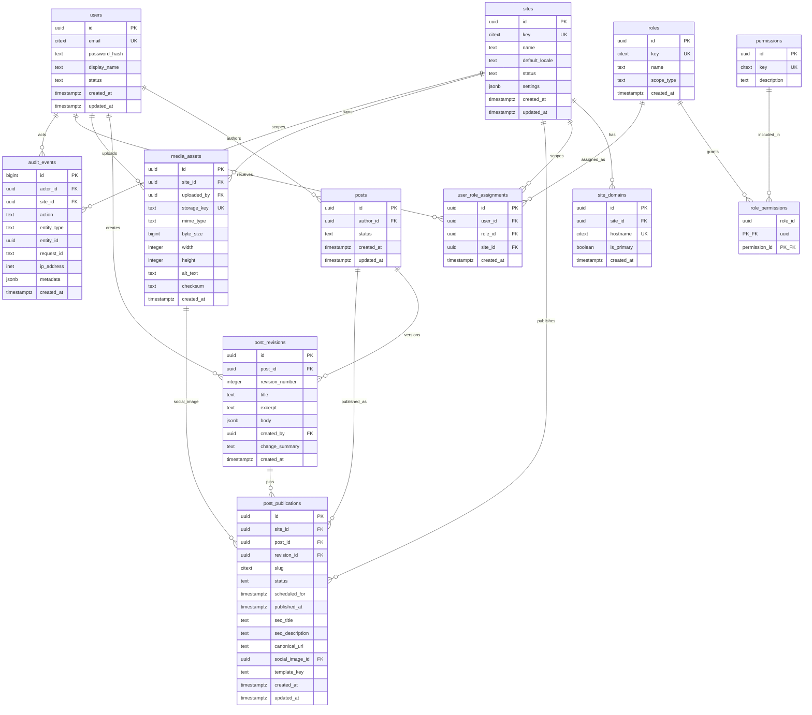

# Entity relationship diagram (proposed)

Status: **design only**. Phase 01 contains no entities and no migrations.

The diagram describes the minimum Phase 02 schema. It favors explicit join tables
and database-enforced scope over JSON fields for relationships. PostgreSQL 18 is
the target.

## Constraint notes

### Users and roles

- `users.email` uses `citext` and is unique. Email changes require re-verification
  in Phase 02+.
- `users.status` is `active`, `suspended`, or `disabled`. Authorization must fail
  closed for non-active users even if a session row still exists.
- `roles.scope_type` is `platform` or `site`.
  - A platform-scoped assignment has `site_id IS NULL`.
  - A site-scoped assignment has `site_id IS NOT NULL`.
- Enforce scope with a check constraint and a unique constraint on
  `(user_id, role_id, site_id) NULLS NOT DISTINCT` (PostgreSQL 15+).
- `user_role_assignments` should use `ON DELETE RESTRICT` for roles and sites, and
  require an explicit cleanup/reassignment workflow before deleting either.
- Role keys are stable strings (`super_admin`, `admin`); display names are
  editable. Authorization checks permission keys, not role display names.

### Content

- `posts.author_id` references the creating user but does not by itself grant
  edit rights. Authorization is site-scoped.
- `post_revisions` has `UNIQUE (post_id, revision_number)` and a composite unique
  key `(post_id, id)` so publications can enforce the revision belongs to the
  post.
- `post_publications` uses a composite foreign key
  `(post_id, revision_id) → post_revisions(post_id, id)`.
- Publication uniqueness:
  - `UNIQUE (site_id, post_id)`;
  - `UNIQUE (site_id, slug)`;
  - a partial unique index for `status = 'published'` if future versions allow
    more than one publication per post per site.
- `scheduled_for` is required when status is `scheduled`; `published_at` is
  required when status is `published`. Check constraints enforce both.
- `template_key` is an allowlisted application value, not free-form code. It
  selects a renderer; it must never become a file path or component name.
- `canonical_url` is nullable and, when present, must be an absolute HTTP(S) URL.

### Domains

- `site_domains.hostname` is unique and stored lowercase with no scheme, port,
  path, or trailing dot.
- A partial unique index enforces at most one `is_primary = true` row per site.
- Domain ownership verification is separate from this table. A verified flag and
  challenge token belong to the later domain-management design.

### Media

- `media_assets.site_id` is nullable only for Super Admin-owned platform assets.
- `storage_key` is unique and opaque. Never derive it directly from a user-supplied
  filename.
- `checksum` supports deduplication and integrity checks.
- Deleting a referenced asset is restricted or soft-deleted according to policy.
- MIME type, byte size, and image dimensions are validated at upload time and
  re-checked server-side.

### Audit

- `audit_events.actor_id` may become nullable for system actions; if so, add
  `actor_type` rather than inventing a fake user.
- `site_id` is nullable only for platform-level actions.
- `ip_address` uses PostgreSQL `inet`, not text.
- Application roles receive `INSERT` and `SELECT` privileges only. Updates and
  deletes are denied at the database-role level.
- High-volume audit storage may move to an append-only external sink later; the
  database remains the immediate source.

## Index plan

| Table                   | Index                                                          | Reason                         |
| ----------------------- | -------------------------------------------------------------- | ------------------------------ |
| `site_domains`          | unique `(hostname)`                                            | public host resolution         |
| `user_role_assignments` | `(user_id, site_id)`                                           | “what can this user access?”   |
| `post_revisions`        | `(post_id, revision_number DESC)`                              | latest revision                |
| `post_publications`     | unique `(site_id, post_id)` and `(site_id, slug)`              | routing and publication lookup |
| `post_publications`     | `(site_id, status, published_at DESC)`                         | public feeds                   |
| `media_assets`          | `(site_id, created_at DESC)`                                   | site media library             |
| `audit_events`          | `(site_id, created_at DESC)` and `(actor_id, created_at DESC)` | investigations                 |

Indexes should be added alongside the query that needs them. Do not pre-create
indexes for hypothetical endpoints.

## Migration rules

1. Every schema change is a reviewed TypeORM migration; `synchronize` stays false.
2. Migrations are forward-only in production. A rollback is a new forward fix,
   except in local development where `migration:revert` is allowed.
3. Use `citext` and `pg_trgm` from the Docker initialization file or create them
   in a dedicated first migration when the managed database does not.
4. Add constraints before application code relies on them.
5. Backfill in a separate migration from the constraint that requires the
   backfill.
6. Never omit a foreign key because “the application checks it.”
