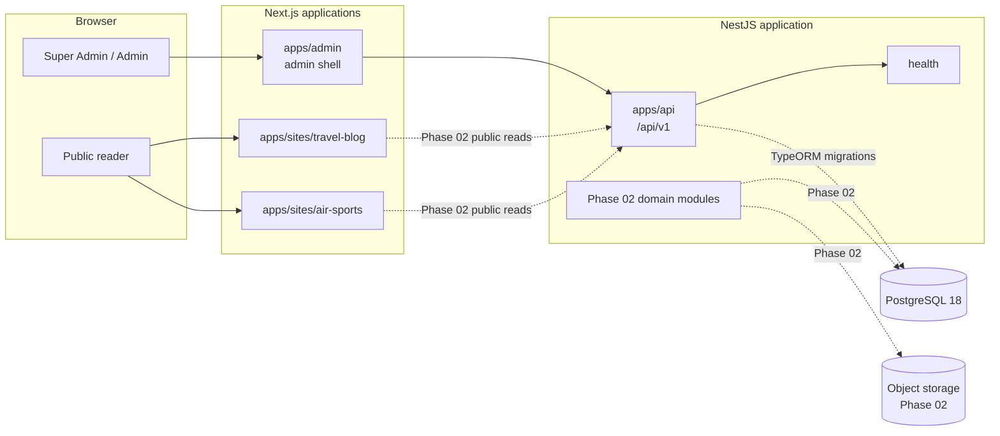

# Architecture overview

## System shape

The repository is one pnpm/Turborepo monorepo with four deployable Next.js or
NestJS applications and eight shared packages (six runtime, two tooling).
Applications own runtime composition; packages own contracts and presentation
primitives.



Solid lines are Phase 01 behavior. Dotted lines are planned Phase 02
integrations and must not be represented as implemented.

## Applications

### Admin (`apps/admin`, port 3000)

- Next.js App Router.
- Server-rendered shell; the API status widget is the only client component.
- A store is created per React tree, never at module scope, to avoid SSR state
  leaking between requests.
- Redux Toolkit and RTK Query are reserved for administrative state and
  server-state caching. Local form state belongs to React Hook Form.
- `robots` is disabled for the entire application.

### API (`apps/api`, port 4000)

- NestJS with global prefix from `API_PREFIX` (`/api/v1`).
- `/health` is **liveness**: the process can serve HTTP. `/health/ready` is
  **readiness**: a 2-second `SELECT 1`, returning 503 when the database is
  unreachable. The connection pool opens lazily, so boot does not require a
  database.
- Every response uses the standard success or error envelope. Errors carry a
  stable machine code and a message localized from `Accept-Language` (`en`, `bn`).
- Request IDs are accepted only when they match a bounded safe pattern;
  otherwise the API generates a UUID.
- Helmet, explicit CORS origins, a 120 request/minute IP throttle, a `BODY_LIMIT`
  body cap, and a strict validation pipe are enabled.
- TypeORM is wired through `DatabaseModule` for migrations and reads only;
  `synchronize` is false in every environment.
- OpenAPI is served at `/api/v1/docs` outside production.

### Public sites (`apps/sites/travel-blog`, `apps/sites/air-sports`)

- Separate Next.js applications with independent typography, density, copy, and
  color tokens.
- No Redux in Phase 01. A public site should prefer server rendering, caching,
  and small client islands over a global client store.
- Each app declares a stable `siteConfig.key` that will map to a `sites` row in
  Phase 02. A site's hostnames and settings are data; its presentation is code
  until a shared template system is justified.
- Public apps currently render static foundation pages only.

## Shared packages and dependency direction

```text
types        validation        tsconfig / eslint-config
  ^              ^
  |              |
api-client    config
  ^              ^
  |              |
redux          ui
  ^              ^
  +------ apps --+
```

Rules:

1. `types` has no runtime dependencies and no framework imports.
2. `validation` may depend on Zod only. It must not import Next.js or NestJS.
3. `config` composes validation and exposes browser-safe constants plus a
   framework-free security-header module.
4. `api-client` is framework-free and cannot import React, Redux, Next.js, or
   NestJS.
5. `redux` may depend on `api-client` and `types`; it must not import Next.js.
6. `ui` may depend on React and presentation utilities; it must not import API,
   Redux, or server code.
7. Applications may depend on packages. Packages must never import applications.
8. Import through package entry points, never `@multi-site-cms/*/src/*`.

Workspace packages are source-only and type-checked in place. Next.js
applications list them in `transpilePackages`; the API imports only the
type-only `types` package.

## Site identity and request context

Site identity has three representations, each with a different trust level:

| Context        | Identifier                    | Trust rule                                                          |
| -------------- | ----------------------------- | ------------------------------------------------------------------- |
| Public browser | Hostname / site key           | Public routing data; never authorizes an administrative action.     |
| Admin browser  | Explicit `siteId` in the path | Must be checked against the authenticated user's active membership. |
| Background job | Immutable `siteId`            | Granted by the job creator and re-checked before side effects.      |

Planned Phase 02 rules:

- `site_domains.hostname` is unique and normalized to lowercase ASCII.
- Public API reads use an explicit public site key or a server-resolved site
  context. The API does not authorize using a caller-controlled `Host` header.
- Admin routes are site-scoped (`/sites/:siteId/...`) and the API resolves
  membership on every request.
- Cross-site resources are never loaded by ID alone. The query includes
  `site_id` (or a verified relation to it).
- Super Admin is the only platform-scoped role and every action is audited.

See [RBAC](rbac.md) and [ADR 0003](../adr/0003-single-api-and-site-context.md).

## Data boundaries

- PostgreSQL is the system of record for sites, users, roles, content,
  publications, and audit events.
- Object storage will hold media bytes; the database holds metadata and access
  scope.
- Browser storage must not hold credentials or authoritative authorization
  state.
- Redis or a queue is not part of Phase 01. Introduce one only when a concrete
  scheduling or cache requirement exists.

## Runtime and deployment units

| Unit            | Runtime       | Scale model                       |
| --------------- | ------------- | --------------------------------- |
| Admin           | Next.js Node  | Independent deployment            |
| Travel site     | Next.js Node  | Independent deployment            |
| Air sports site | Next.js Node  | Independent deployment            |
| API             | NestJS Node   | Independently scaled HTTP service |
| PostgreSQL      | Managed PG 18 | Managed backup/PITR               |

Independent site deployments isolate branding and failure domains at the cost of
more deployments. See [ADR 0002](../adr/0002-independent-site-apps.md).

## Phase boundary

Phase 01 contains infrastructure and shells. Phase 02 adds authentication, the
database schema, content, media, and publishing. The design documents describe
Phase 02 so that Phase 01 does not encode contradictory assumptions; they do not
authorize Phase 02 implementation.
