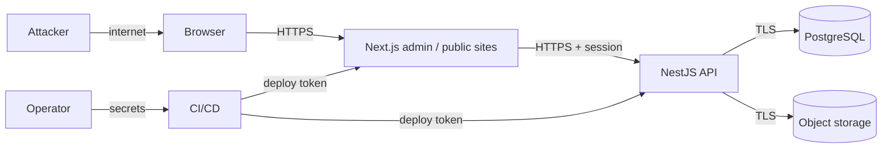

# Threat model

Status: baseline for Phase 01, extended in Phase 02. Phase 01 implements the
transport-level controls only; identity and content controls are design.

## Assets

| Asset                             | Why it matters                                     |
| --------------------------------- | -------------------------------------------------- |
| Admin credentials and sessions    | Full control of tenant content and publishing      |
| Unpublished content and revisions | Competitive and editorial value before publication |
| Per-tenant media                  | Private assets must not leak across sites          |
| Site settings and domains         | Branding, SEO, and routing integrity               |
| Audit log                         | Accountability and incident reconstruction         |
| Database and object storage       | Single point of total compromise                   |
| Secrets and connection strings    | Direct path to the database and hosting account    |

## Actors

- Anonymous reader — may only read published content for the resolved site.
- Authenticated Admin — trusted for assigned sites only.
- Super Admin — trusted platform-wide, highest-value target.
- Platform operator — controls deployment, secrets, and backups.
- External attacker — unauthenticated or a compromised low-privilege account.

## Trust boundaries

Every arrow is a boundary where input is untrusted until validated and the actor
is unauthorized until proven.

## Threats and controls

### Identity and session

| Threat                   | Control                                                   | Phase |
| ------------------------ | --------------------------------------------------------- | ----- |
| Credential stuffing      | Throttled login, generic failure message, lockout/backoff | 02    |
| Session theft via XSS    | `HttpOnly` cookies, output sanitization, strict CSP       | 02    |
| CSRF                     | Origin check plus token on state-changing requests        | 02    |
| Session fixation         | Rotate session id on login and privilege change           | 02    |
| Privilege escalation     | Role assignment restricted to Super Admin, audited        | 02    |
| Last Super Admin lockout | Cannot demote/disable the final `super_admin`             | 02    |

### Authorization

| Threat                      | Control                                                   | Phase |
| --------------------------- | --------------------------------------------------------- | ----- |
| IDOR on tenant rows         | Guard + `site_id`-scoped query + object ownership check   | 02    |
| Cross-tenant media exposure | Site-scoped assets; cross-site reuse is explicit, audited | 02    |
| Forged `siteId` from client | Server-resolved membership; path value is a lookup key    | 02    |
| Hidden-UI-only protection   | All checks server-side                                    | 02    |

### Input and output

| Threat                           | Control                                                     | Phase |
| -------------------------------- | ----------------------------------------------------------- | ----- |
| Mass-assignment                  | DTO whitelist, `forbidNonWhitelisted`                       | 01 ✅ |
| Injection (SQL, template, shell) | Parameterized queries, no string-built SQL, no dynamic exec | 01 ✅ |
| Stored XSS through rich text     | Sanitize on render with an allowlist                        | 02    |
| Unbounded payload                | Body size cap, pagination caps, upload limits               | 01/02 |
| Path traversal in uploads        | Opaque storage keys, never user filenames                   | 02    |

### Availability and abuse

| Threat                 | Control                                                     | Phase |
| ---------------------- | ----------------------------------------------------------- | ----- |
| Brute-force / scraping | 120 req/min/IP throttle; login-specific limits in Phase 02  | 01 ✅ |
| Expensive query abuse  | Bounded pagination, indexes, statement timeouts planned     | 01/02 |
| Dependency compromise  | Minimal dependency set, lockfile, frozen CI installs        | 01 ✅ |
| Free-tier exhaustion   | Quotas documented; alerts before limit; upgrade path stated | 01 ✅ |

### Infrastructure and secrets

| Threat                       | Control                                                       | Phase |
| ---------------------------- | ------------------------------------------------------------- | ----- |
| Secret in repository         | `.gitignore` for `.env*`, only `.env.example` committed       | 01 ✅ |
| Secret in client bundle      | `NEXT_PUBLIC_*` restricted to non-sensitive values            | 01 ✅ |
| Unauthorized admin interface | Baseline security headers, CORS allowlist, `noindex` on admin | 01 ✅ |
| Data loss                    | Managed backups plus a restore drill before production data   | 02    |
| Audit tampering              | Append-only privileges for the application role               | 02    |

## Phase 01 controls actually implemented

- Helmet defaults on the API; `x-powered-by` disabled.
- Explicit CORS allowlist from `CORS_ORIGINS`; no wildcard with credentials.
- Global throttler at 120 requests/minute/IP, keyed by client IP with
  `TRUST_PROXY` explicitly configured.
- `ValidationPipe` with `whitelist` and `forbidNonWhitelisted`.
- Request ID validation (`^[A-Za-z0-9._:-]{8,128}$`) with UUID fallback, echoed in
  headers and envelopes.
- Error responses never expose stack traces or internal messages above 5xx.
- Baseline browser headers on the Next.js applications via
  `@multi-site-cms/config` (`X-Content-Type-Options`, `X-Frame-Options: DENY`,
  `Referrer-Policy`, `Permissions-Policy`).
- Admin application disallows indexing; health responses are `no-store`.

Not yet implemented, and not to be claimed: HSTS (belongs to the platform/CDN),
CSP (deferred until the third-party surface is known), authentication, audit
logging, backup automation.

## Residual risks accepted in Phase 01

1. No authentication exists, so the API must not be exposed publicly with
   privileged endpoints. It has none today.
2. Throttling is in-process; multiple instances multiply the effective limit.
   Acceptable until a shared store exists.
3. No CSP or HSTS yet; both require the deployment platform decision.
4. Local development uses a fixed database password, which is never valid in a
   deployed environment.

## Phase 02 schema controls

| Control                                                    | Status             | Where                                                |
| ---------------------------------------------------------- | ------------------ | ---------------------------------------------------- |
| Cross-site references rejected by composite foreign keys   | ✅ 02              | `post_publications`, publication joins               |
| One publication per post per site                          | ✅ 02              | `UQ_post_publications_site_post`                     |
| Slug uniqueness scoped per site                            | ✅ 02              | `UQ_post_publications_site_slug`                     |
| Publication state consistency enforced                     | ✅ 02              | `CHK_post_publications_schedule/published`           |
| Password hash excluded from default selects                | ✅ 02              | `User.passwordHash` (`select: false`)                |
| No privileged account created by seeds or an open endpoint | ✅ 02              | Development seed; ADR-0012                           |
| Audit actor cannot be faked as a user without an id        | ✅ 02              | `CHK_audit_events_actor`                             |
| Audit append-only at the database-privilege level          | ⏳ deploy          | Application role gets `INSERT`/`SELECT` only         |
| Row-Level Security                                         | ➖ not implemented | Application authorization is mandatory; see ADR-0009 |

Residual risks accepted in Phase 02:

1. **The database cannot authorize.** It enforces integrity and same-site
   references, not who may read a projection. A service that omits `site_id` from
   a predicate still leaks data within the boundaries it queries. Denial-path
   tests are mandatory in the API phase.
2. **Platform-scoped media cannot be a featured image.** Guaranteed by the same
   composite key that blocks cross-site media use. If the product needs it, that
   is a deliberate schema change, not a service workaround.
3. **Direct database access bypasses every control.** Deploying with a shared
   superuser credential would defeat the model; the runtime role must be least
   privileged and separate from the migration role.
4. **No RLS yet**, so a bug in a raw query is not contained by the database.

## Review triggers

Re-open this model when any of these happen: authentication lands, media upload
lands, a new integration is added (email, analytics, payments), a new role is
introduced, hosting changes, or a cross-site sharing feature is proposed.
