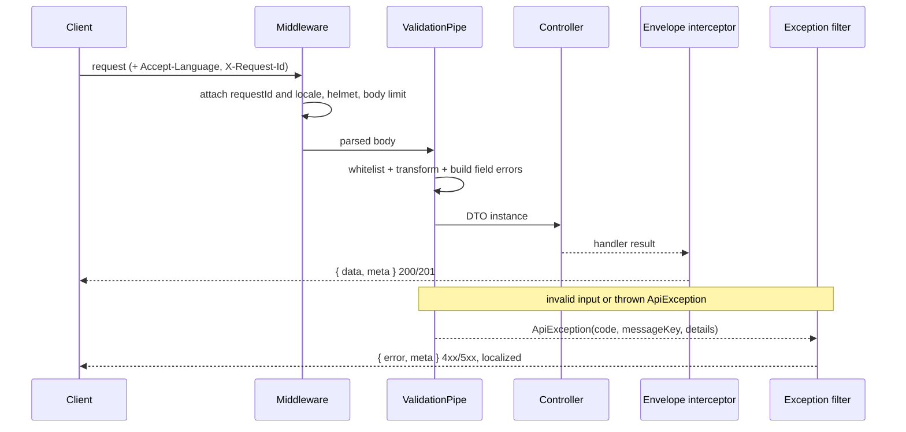

# Backend overview

NestJS modular monolith serving every publication from one deployment. Status:
**Phase 03 foundation** — HTTP infrastructure, configuration, persistence wiring,
and operational endpoints exist; identity, content, media, and publishing modules
do not.

## Module structure

```text
apps/api/src/
  main.ts                     process entry (composition only)
  app.module.ts               module graph and global providers
  bootstrap.ts                HTTP infrastructure (prefix, CORS, limits, validation)

  config/env.ts               typed, validated configuration

  common/
    exceptions/api.exception.ts        typed exception: status + code + message key
    filters/all-exceptions.filter.ts   single error response writer
    http/
      error-code.ts                    status → machine code / message key
      error-payload.ts                 the only error-envelope builder
      request-context.ts               request id + locale attached by middleware
      validation.exception.ts          ValidationPipe exception factory
      openapi-error.dto.ts             documented envelope schemas
    i18n/
      locale.ts                        Accept-Language negotiation (en, bn)
      messages.ts                      message catalogs
      translate.ts                     key → message with fallback
      locale.middleware.ts             attaches the negotiated locale
      validation-messages.ts           class-validator constraint → message key
    interceptors/
      request-logging.interceptor.ts   one structured line per request
      response-envelope.interceptor.ts `{ data, meta }`
    logging/json-logger.ts             JSON logger with redaction
    middleware/
      request-id.middleware.ts         bounded correlation id
      body-parser-error.middleware.ts  413 in the standard envelope

  database/
    database.module.ts          global module: DataSource provider, lifecycle, probe
    database-options.ts         shared options factory (runtime, CLI, tests)
    database.tokens.ts          DATA_SOURCE injection token
    database-health.service.ts  readiness check (`SELECT 1`)
    data-source.ts              CLI entry point
    entities/                   18 entities from Phase 02
    migrations/                 3 migrations + explicit registry
    seeds/                      idempotent development seed

  health/
    health.controller.ts        liveness and readiness
    health.dto.ts               documented response schemas
    health.module.ts

  openapi/openapi.ts            document creation and docs mounting
```

## Responsibilities

| Component       | Owns                                                           | Must not                                           |
| --------------- | -------------------------------------------------------------- | -------------------------------------------------- |
| `main.ts`       | process wiring, logger, listen, startup failure                | contain routing, business rules, or config parsing |
| `bootstrap.ts`  | global prefix, middleware order, CORS, body limits, validation | know about any domain                              |
| `config/env.ts` | parse and validate environment, production guards              | leak values in errors or logs                      |
| `common/*`      | cross-cutting HTTP, error, i18n, logging infrastructure        | import a feature module                            |
| `database/*`    | connection lifecycle, entities, migrations, probe              | contain business queries                           |
| `health/*`      | liveness/readiness contracts                                   | perform expensive work                             |
| `openapi/*`     | document the implemented surface                               | document endpoints that do not exist               |

## Request lifecycle



## Boundaries

- Controllers handle HTTP only; application behaviour belongs in services. No
  service exists yet, by design.
- Entities are persistence models. They carry no HTTP decorators and no response
  shaping.
- `common` never imports `health`, `database`, or a future feature module.
- Feature modules will arrive with their phase: `identity`, `sites`, `content`,
  `media`, `publishing`, `audit`. They are not scaffolded as empty folders.

## Where the rest is documented

- [API standards](api-standards.md) — versioning, validation, envelopes, errors, localization.
- [Configuration](configuration.md) — every environment variable.
- [Database integration](database.md) — pooling, migrations, readiness.
- [Backend security](security.md) — implemented controls and Phase 04 boundary.
- [Development workflow](development.md) — commands and verification.
