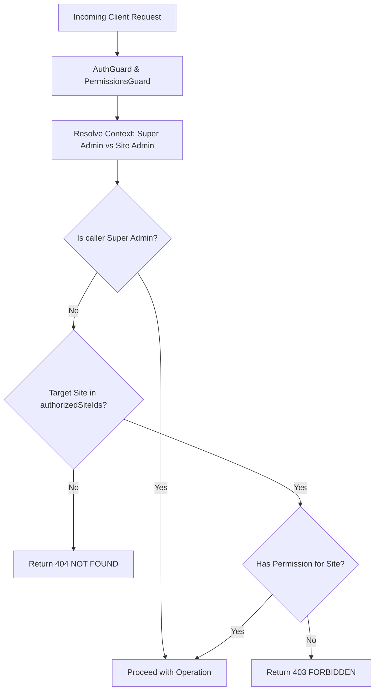

# Content Authorization & Multi-Tenant Isolation

## 1. Security Architecture

The authorization model enforces strict tenant boundaries at the database and application levels. Client-side hiding of UI elements is treated as user experience only; all access controls are asserted server-side.

---

## 2. Invariants & Rules

### 1. Super Admin Authority

- Super Admins have platform-wide scope (`scopeType: 'platform'`).
- They can view and manage canonical posts across all sites, restore soft-deleted posts, and administer platform-level media.

### 2. Client Admin Site Scoping

- Client Admins possess site-scoped role assignments (`scopeType: 'site'`, `siteId: <UUID>`).
- Client Admins can read, create, and update posts and publications only on sites explicitly listed in their `authorizedSiteIds`.
- Client Admins cannot grant themselves Super Admin privileges or elevate role permissions.

### 3. Opaque 404 Denial on Cross-Tenant Access

- When a Client Admin attempts to read, modify, or publish content for an unassigned website, the server returns **HTTP 404 NOT FOUND** rather than 403 Forbidden.
- This prevents IDOR enumeration, metadata discovery, and tenant existence leakage.

---

## 3. RBAC Permissions Matrix

| Permission            | Description                                   | Target Resources                                         |
| --------------------- | --------------------------------------------- | -------------------------------------------------------- |
| `post:read`           | Read canonical posts and publications         | `/posts`, `/sites/:id/publications`                      |
| `post:create`         | Create canonical posts                        | `/posts`                                                 |
| `post:update`         | Update canonical posts & restore revisions    | `/posts/:id`, `/posts/:id/revisions/:num/restore`        |
| `post:delete`         | Soft-delete / archive canonical posts         | `/posts/:id` (restore: Super Admin only)                 |
| `publication:publish` | Create or update site publications            | `/posts/:id/publications`, `/sites/:id/publications/:id` |
| `publication:archive` | Archive / unpublish site publications         | `/sites/:id/publications/:id`                            |
| `taxonomy:manage`     | Create, update, or delete categories and tags | `/sites/:id/categories`, `/sites/:id/tags`               |
| `media:upload`        | Register media asset metadata                 | `/media`                                                 |
| `media:delete`        | Archive / delete media asset metadata         | `/media/:id`                                             |
