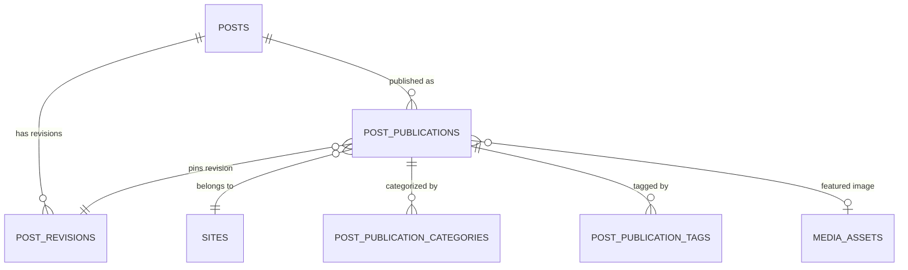

# Canonical Content Model

## 1. Overview

The `multi-site-cms` content engine decouples source content from public site distribution. A single canonical post item in `posts` represents the shared editorial intent and master record, while independent publication records in `post_publications` control how, when, and where the content appears on individual websites.

---

## 2. Supported Content Types

The system supports strongly typed content categories governed by the database check constraint `CHK_posts_type`:

| Type Enum           | Purpose                                                 | Target Websites            |
| ------------------- | ------------------------------------------------------- | -------------------------- |
| `article`           | Standard editorial narrative, long-form post            | Travel Blog, Generic Sites |
| `guide`             | Instructional, step-by-step documentation               | All Sites                  |
| `travel_guide`      | Destination guide, itineraries, travel tips             | Travel Blog                |
| `news`              | Time-sensitive news announcements                       | All Sites                  |
| `live_update`       | Rapid timestamped updates                               | Air Sports Live            |
| `air_sports_update` | Flight conditions, airspace alerts, event broadcasts    | Air Sports Live            |
| `event_update`      | Schedule changes, competition rounds, athlete standings | Air Sports Live            |

---

## 3. Schema & Fields

### Canonical Post (`posts`)

- `id` (`uuid`, PK): Immutable identity generated via `gen_random_uuid()`.
- `author_id` (`uuid`, FK -> `users.id`): Creator/owner of the source document.
- `type` (`text`): One of the supported `PostType` enum values.
- `status` (`text`): Workflow state (`draft`, `in_review`, `approved`, `archived`).
- `source_locale` (`text`): Default authoring language code (`en`, `bn`). Defaults to `'en'`.
- `deleted_at` (`timestamptz`, nullable): Soft-deletion timestamp. When set, excludes post from all public and ordinary administrative queries.
- `created_at` (`timestamptz`): Record creation timestamp.
- `updated_at` (`timestamptz`): Record modification timestamp.

### Structured Editor Document (`body`)

Content bodies are persisted as structured AST documents rather than raw HTML strings:

- Root element: `{ "type": "doc", "content": [...] }`
- Node types: `paragraph`, `heading`, `text`, `bulletList`, `orderedList`, `listItem`, `image`, `codeBlock`, `blockquote`
- Marks: `bold`, `italic`, `strike`, `code`, `link`
- Security constraints: Link URLs (`href`) and media sources (`src`) are validated to ensure only approved schemes (`http:`, `https:`, `mailto:`, `tel:`) are allowed. Any `javascript:`, `data:`, or `vbscript:` URI is rejected with HTTP 400 Bad Request.
