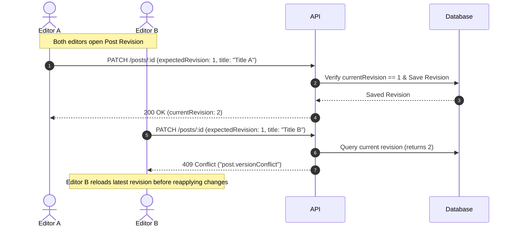

# Revision History & Optimistic Concurrency Control

## 1. Overview

Content editorial history is preserved in `post_revisions`. Every time an editor modifies a post's `title`, `excerpt`, or `body`, a new immutable revision snapshot is inserted with an incremented `revision_number`. Past revisions are never mutated or deleted.

---

## 2. Optimistic Concurrency Control (OCC)

To prevent simultaneous edits from overwriting each other, `UpdatePostDto` accepts an optional `expectedRevisionNumber`:

- If `expectedRevisionNumber` matches the current latest revision number, the update proceeds.
- If another user updated the post in the interim and incremented the revision number, the check fails and throws HTTP 409 Conflict (`CONFLICT`, `post.versionConflict`).
- The client UI can catch the 409 error, present a side-by-side diff to the user, and reload the latest content without silent data loss.

---

## 3. Safe Reversion / Rollback Workflow

Restoring an older revision snapshot does **not** roll back or delete intermediate revisions:

1. When calling `POST /api/v1/posts/:postId/revisions/:revisionNumber/restore`, the system reads the snapshot content for `:revisionNumber`.
2. A new revision is created whose revision number is `latestRevisionNumber + 1`.
3. The post's `updatedAt` is updated to current time.
4. An audit record `post.update` is logged detailing `restoredFromRevision` and `newRevisionNumber`.
5. Revisions #1, #2, and all intermediate records remain strictly intact and auditable.
