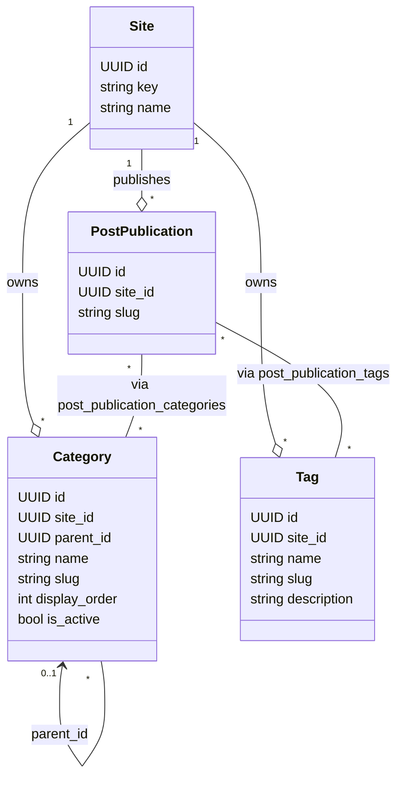

# Site-Scoped Taxonomy (Categories & Tags)

## 1. Overview

Taxonomy terms (`categories` and `tags`) are strictly scoped to individual sites (`site_id`). A category or tag created on `Travel Blog` has no visibility or availability on `Air Sports Live`.

Publications associate with categories and tags through composite foreign key join tables (`post_publication_categories` and `post_publication_tags`), guaranteeing that a publication on Site A cannot reference a category on Site B.



---

## 2. Category Hierarchies & Cycle Prevention

Categories support arbitrary parent-child nesting via `parent_id`:

- Root categories have `parent_id = null`.
- Subcategories specify `parent_id = parent.id`.
- Foreign key `FK_categories_parent` enforces that both parent and child belong to the same `site_id`:
  ```sql
  FOREIGN KEY ("parent_id", "site_id") REFERENCES "categories" ("id", "site_id") ON DELETE SET NULL
  ```

### Circular Reference Detection

To prevent recursive infinite loops, `validateCategoryHierarchy` performs ancestor traversal before any parent update:

1. Rejects self-referencing updates (`categoryId === newParentId`).
2. Iterates up the ancestor hierarchy starting from `newParentId`.
3. If `categoryId` is encountered in the ancestor path, a circular loop is identified.
4. The API rejects the request with HTTP 400 Bad Request (`VALIDATION_ERROR`, `category.cycleDetected`).

---

## 3. Taxonomy Endpoints

All taxonomy endpoints require `taxonomy:manage` for mutations and `post:read` for listings.

| Method   | Path                                   | Action                                     | Permission        |
| -------- | -------------------------------------- | ------------------------------------------ | ----------------- |
| `POST`   | `/api/v1/sites/:siteId/categories`     | Create category                            | `taxonomy:manage` |
| `GET`    | `/api/v1/sites/:siteId/categories`     | List categories (paged, search, hierarchy) | (authenticated)   |
| `GET`    | `/api/v1/sites/:siteId/categories/:id` | Get category details                       | (authenticated)   |
| `PATCH`  | `/api/v1/sites/:siteId/categories/:id` | Update category / parent                   | `taxonomy:manage` |
| `DELETE` | `/api/v1/sites/:siteId/categories/:id` | Delete category                            | `taxonomy:manage` |
| `POST`   | `/api/v1/sites/:siteId/tags`           | Create tag                                 | `taxonomy:manage` |
| `GET`    | `/api/v1/sites/:siteId/tags`           | List tags                                  | (authenticated)   |
| `GET`    | `/api/v1/sites/:siteId/tags/:id`       | Get tag details                            | (authenticated)   |
| `PATCH`  | `/api/v1/sites/:siteId/tags/:id`       | Update tag                                 | `taxonomy:manage` |
| `DELETE` | `/api/v1/sites/:siteId/tags/:id`       | Delete tag                                 | `taxonomy:manage` |
