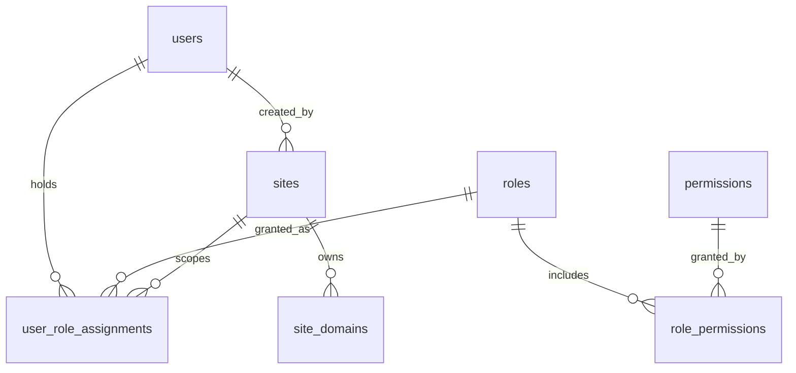
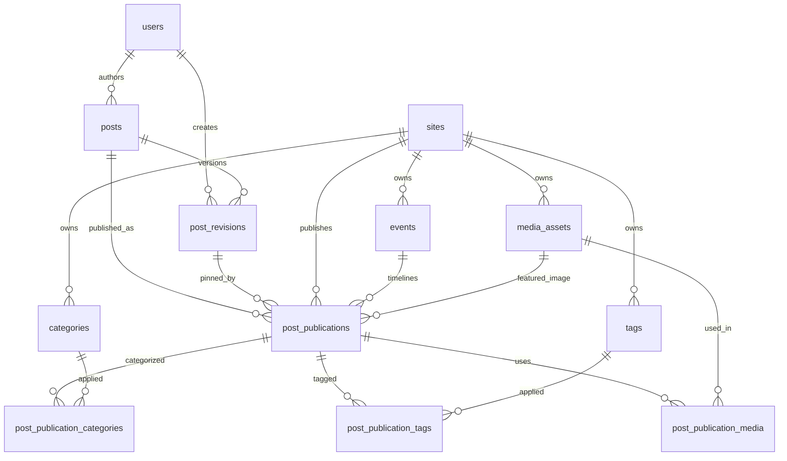
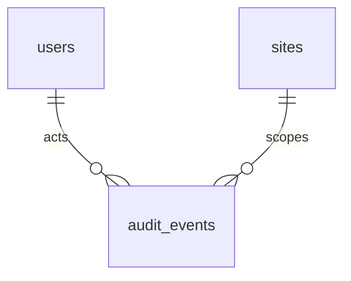

# Entity relationship diagram

Status: **implemented** by the Phase 02 migrations
(`1793491200000`–`1793491202000`). This diagram is the schema as created, not a
proposal.

## Identity, authorization, and site registry

`user_role_assignments` carries `scope_type` denormalized from `roles` so the
composite foreign key `(role_id, scope_type) → roles(id, scope_type)` prevents a
platform role from being granted at site scope, or a site role from being granted
globally.

## Content, publication, taxonomy, and events

## Audit

## How to read the model in plain language

1. **A post is global.** It has an author, a type, and an editorial state. It does
   not belong to a site.
2. **A revision is an immutable snapshot.** Editing adds a row. Nothing updates a
   published body in place.
3. **A publication is a site showing one revision.** It owns the site's slug,
   status, schedule, SEO fields, featured image, template key, and optional event.
4. **Taxonomy belongs to the site.** A category is attached to a publication, not
   to the post, so the same post can be filed differently on each site.
5. **Media belongs to a site** (or to the platform, for Super Admin assets).
   A publication can only reference media from its own site.
6. **An event belongs to a site.** Live updates are ordinary publications of type
   `live_update` linked to an event and ordered by `published_at`.
7. **Authorization is a separate graph.** Users hold roles; roles hold permissions;
   site-scoped assignments are the site-access grant.

## Width of the model

Eighteen tables exist. Deliberately absent: redirects, outbox events, scheduled
jobs, sessions, categories hierarchy, event sessions/stages, translation groups,
comments, newsletters. Each is documented as deferred with its trigger in
[data ownership](data-ownership.md#deferred-tables).

## Query patterns

Every non-trivial index exists for one of these queries.

| Query                                      | Index                                         |
| ------------------------------------------ | --------------------------------------------- |
| Resolve tenant by hostname                 | `UQ_site_domains_hostname` (unique)           |
| Resolve tenant by stable key               | `UQ_sites_key` (unique)                       |
| Public feed: site, published, newest first | `IDX_post_publications_site_status_published` |
| Public article: site + slug                | `UQ_post_publications_site_slug` (unique)     |
| Scheduling worker: due scheduled rows      | `IDX_post_publications_due` (partial)         |
| Event timeline: publications for an event  | `IDX_post_publications_event` (partial)       |
| Admin post list by author                  | `IDX_posts_author_created`                    |
| Latest revision for a post                 | `UQ_post_revisions_post_number` (unique)      |
| Media library for a site                   | `IDX_media_assets_site_created`               |
| Media deduplication by checksum            | `IDX_media_assets_checksum`                   |
| "Where is this asset used?"                | `IDX_post_publication_media_asset`            |
| Publications in a category                 | `IDX_post_publication_categories_category`    |
| Publications with a tag                    | `IDX_post_publication_tags_tag`               |
| Audit log for a site, newest first         | `IDX_audit_events_site_created`               |
| Audit log for an actor                     | `IDX_audit_events_actor_created`              |
| Audit log by action                        | `IDX_audit_events_action_created`             |
| Audit log for an entity                    | `IDX_audit_events_entity`                     |
| Events for a site by start time            | `IDX_events_site_start`                       |
| Sign-in by email                           | `UQ_users_email` (unique, `citext`)           |
| "What can this user access?"               | `IDX_user_role_assignments_user_site`         |

No table exceeds four indexes. `categories`, `tags`, and `events` get their
site-scoped lookup from the leading column of a unique constraint instead of a
redundant second index.
