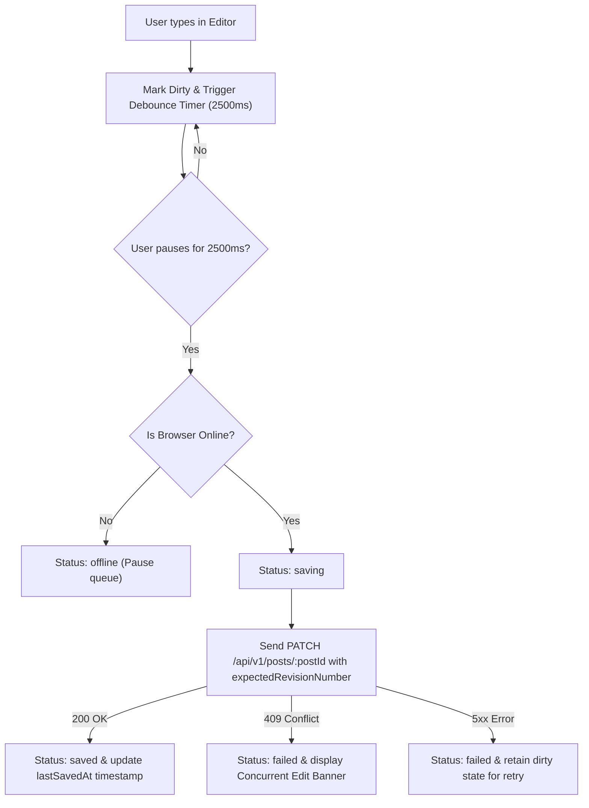

# Autosave, Draft Recovery & Optimistic Concurrency Control

## Overview

Content editing involves continuous drafting, potential connectivity drops, and concurrent editors. The editorial UI implements a multi-tier resilience architecture:

1. **Debounced Autosave**: Automatic background synchronization after user pauses editing.
2. **Session Storage Draft Recovery**: Protection against accidental tab closes and browser crashes.
3. **Optimistic Concurrency Control (OCC)**: Version-checked revision updates preventing silent data overwrites.

## Debounced Autosave Pipeline (`useAutosave.ts`)

- **Delay Strategy**: 2500ms delay balances server load against the risk of unpersisted text.
- **Save Status Indicator**: Displays real-time state (`Saved`, `Saving...`, `Failed (Unsaved Changes)`, `Offline`).
- **Immediate Save Option**: The editor can click the "Save Draft" button at any time to bypass the debounce timer.

## Draft Recovery (`useDraftRecovery.ts`)

- **Session Draft Caching**: Every unsaved edit writes a lightweight snapshot (`{ savedAt, data }`) to the browser's `sessionStorage` under `cms_draft_<postId>`.
- **Restoration Prompt**: If the user reloads or navigates back to a post that has a newer `sessionStorage` draft than the server revision, a "Draft Recovery Available" banner appears, allowing the editor to restore the recovered draft with one click or dismiss it.
- **Navigation Guard (`beforeunload`)**: If `isDirty` is true when the user attempts to close the browser tab or reload, the standard browser unload prompt warns that changes may not be saved.

## Optimistic Concurrency Control (OCC)

When multiple editors edit the same post simultaneously:

- Each update sends `expectedRevisionNumber: currentRevisionNumber`.
- The backend verifies that the database revision matches `expectedRevisionNumber`.
- If another editor saved revision #4 while editor B was working on revision #3, the backend rejects B's update with `HTTP 409 CONFLICT`.
- The frontend catches HTTP 409 and surfaces an explicit alert informing the editor that a newer revision exists, avoiding silent overwriting of work.
