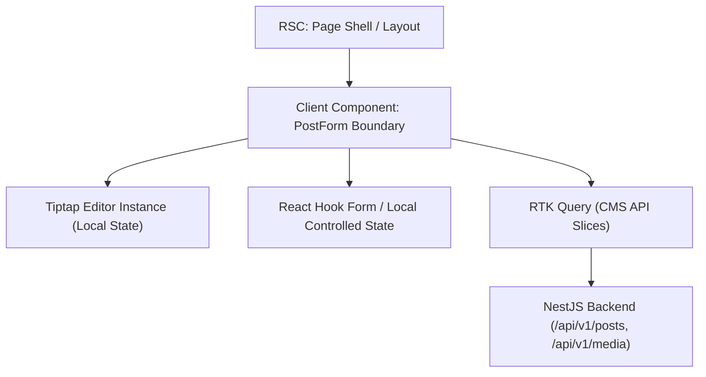

# Editor Architecture & React 19 Integration

## Overview

The rich-text editorial system in `multi-site-cms` is built upon **Tiptap 3 / ProseMirror**, providing a headless, unstyled foundation decoupled from the presentation styles of individual publication sites (such as Travel Blog or Air Sports).

The editor is integrated directly into the centralized administrative shell (`apps/admin`) with a clear architectural boundary separating React Server Components (RSC) and Client Components.

## Server / Client Component Boundary

1. **Server Components Outside Interactive Boundary**:
   - Page route wrappers (`/posts`, `/posts/new`, `/posts/[postId]/edit`) run on the server to establish layout structure, stream document skeletons, and enforce Next.js server security standards.
2. **Interactive Client Component Boundary (`'use client'`)**:
   - `PostForm`, `RichTextEditor`, and `MediaLibraryModal` are explicitly marked with `'use client'`, containing interactive DOM bindings, event listeners, and Web APIs (`sessionStorage`, `navigator.onLine`).
3. **State Isolation**:
   - **Editor State**: Managed locally inside Tiptap's ProseMirror state tree. Document AST is serialized into JSON on content change callbacks without storing bulky ProseMirror transactions in Redux.
   - **Form State**: Lightweight form fields (`title`, `excerpt`, `type`, `sourceLocale`, `publications`) are managed in React state.
   - **Server State**: Managed strictly through **RTK Query** (`cms-api.ts`). Server responses are cached and invalidated via tags (`Post`, `Media`, `Site`). No server entities are duplicated into client-side Redux slices.

## Headless Architecture & Extensibility

- **Branding Agnostic**: The editor emits and consumes standard semantic HTML and structured ProseMirror JSON (`doc` schema with nodes and marks). It does not import or depend on CSS rules from the public sites.
- **Floating Toolbar & Bubble Menu**: An event-driven selection toolbar displays contextual formatting actions (bold, italic, code, links, headings) when text is highlighted, dynamically calculating DOM coordinates via `coordsAtPos` without heavy external dependencies.
- **Word & Character Metrics**: Real-time word count, character count, and estimated reading time calculations are provided via `@tiptap/extension-character-count` and displayed in an unobtrusive bottom status bar.
