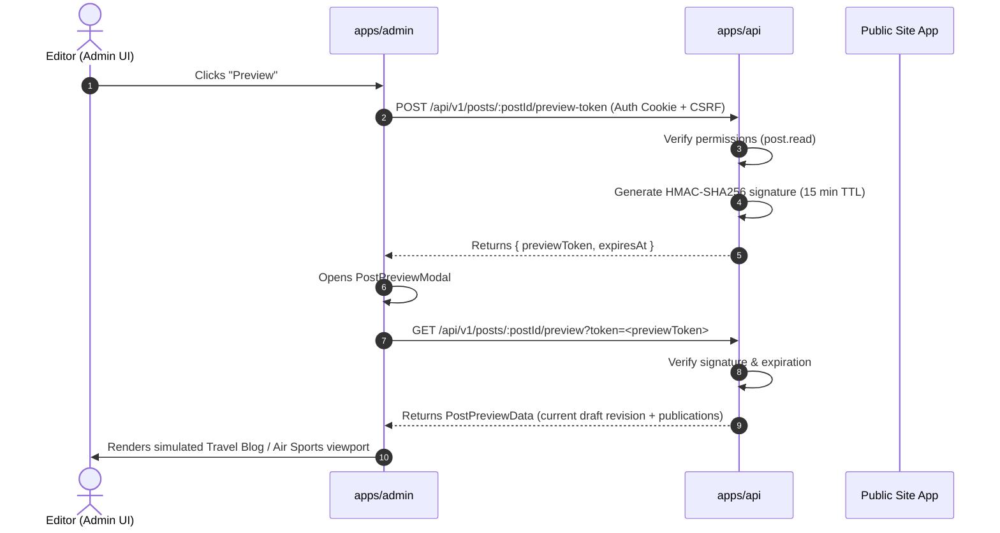

# Content Preview & Ephemeral Token System

## Overview

Authors and editors need to preview unpublished drafts in realistic site layouts before making them live. The preview system provides authenticated, tamper-proof previews without making unpublished drafts publicly discoverable.

## HMAC-Signed Ephemeral Preview Tokens



### 1. Token Generation (`POST /api/v1/posts/:postId/preview-token`)

- Requires an authenticated user with permission to view the post.
- Emits a signed token containing:
  - `postId`
  - `userId`
  - `expiresAt` (Unix timestamp, default 15 minutes)
  - `hmac`: Computed using `crypto.createHmac('sha256', secret).update(...).digest('hex')`

### 2. Preview Retrieval (`GET /api/v1/posts/:postId/preview?token=...`)

- **Signature Verification**: Recomputes HMAC over payload components. Rejects tampered tokens with `401 Unauthorized`.
- **Expiration Check**: Rejects tokens older than 15 minutes with `401 Unauthorized` (`post.previewTokenExpired`).
- **Crawler Suppression**: Responses always include HTTP header:
  ```http
  X-Robots-Tag: noindex, nofollow
  ```
  This guarantees search engines never index draft preview URLs if accidentally shared or logged.

## Modal Simulation Viewport (`PostPreviewModal.tsx`)

The preview modal in `@multi-site-cms/admin` allows authors to toggle between simulated site presentation contexts:

- **Travel Blog Viewport**: Serif editorial typography, prominent hero image, reading time badge, styled destination info cards.
- **Air Sports Viewport**: High-contrast sans-serif styling, live event alert banners, wind and meteorological indicators, event timeline cards.
- **Device Viewports**: Quick toggles between Desktop, Tablet, and Mobile viewport widths.
