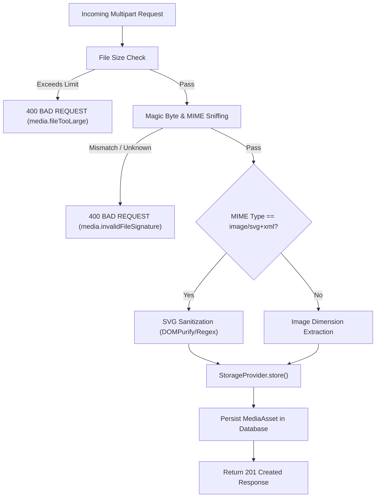

# Media Upload Architecture & File Validation

## Overview

The media upload pipeline handles binary multipart file uploads with strict server-side validation to prevent arbitrary file upload vulnerabilities, extension spoofing, and Stored XSS.

## Upload Endpoint Contract

- **Route**: `POST /api/v1/media/upload`
- **Content-Type**: `multipart/form-data`
- **Authentication**: Session cookie (`multi_site_cms_access_token`)
- **CSRF Protection**: Double-submit CSRF cookie & header (`x-csrf-token`)
- **Authorization**: Requires `media.create` permission within the target `siteId`.

### Form Fields

- `file`: The binary file payload (required).
- `siteId`: UUID of the site owning the asset (required).
- `altText`: Descriptive alternative text for accessibility (optional).
- `caption`: Editorial caption (optional).

## Multi-Layer Validation Pipeline

### 1. File Size Limits

- **Images & Documents**: Max 15 MB.
- **Audio & Video**: Max 50 MB.

### 2. Magic Byte Sniffing (`file-validator.ts`)

Client-supplied `Content-Type` headers and file extensions are treated as untrusted input. The server inspects the first 12–32 bytes of the file buffer to verify true file signatures:

- **PNG**: `89 50 4E 47 0D 0A 1A 0A`
- **JPEG**: `FF D8 FF`
- **GIF**: `47 49 46 38 37 61` or `47 49 46 38 39 61`
- **WebP**: `52 49 46 46 ... 57 45 42 50`
- **AVIF**: `.... 66 74 79 70 61 76 69 66`
- **PDF**: `25 50 44 46 2D` (`%PDF-`)
- **MP4**: `.... 66 74 79 70` (`ftyp`)

If a Windows executable (`.exe` starting with `4D 5A`) is renamed to `picture.jpg`, magic byte validation immediately catches the spoof and rejects the request with HTTP 400 (`media.invalidFileSignature`).

### 3. SVG Sanitization

SVG files can contain embedded `<script>` tags, HTML attributes with inline JavaScript (`onload`, `onerror`), and `javascript:` URIs. All incoming SVGs undergo strict sanitization:

- Strip all `<script>` and `<iframe>` blocks.
- Strip all event handler attributes (`on\w+=`).
- Strip all `href="javascript:..."` links.

### 4. Dimension Extraction

For raster images (PNG, JPEG, GIF, WebP), dimensions (`width` and `height`) are parsed directly from image header chunks, allowing the frontend to reserve layout space and prevent Cumulative Layout Shift (CLS).
