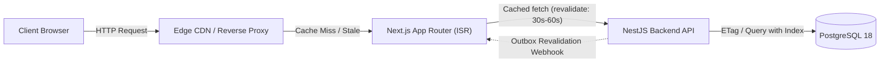

# Performance Baseline, Caching Strategy & Load Testing Plan

This document establishes measured performance benchmarks, caching parameters, and load testing guidelines for the `multi-site-cms` monorepo.

---

## 1. Measured Build Outputs & Bundle Analysis

Measured during production build (`pnpm build` via Next.js 16 Turbopack compiler):

| Application                  | Primary Route          | Page Type              | Static Generation / ISR   | First Load JS (Gzipped)          |
| :--------------------------- | :--------------------- | :--------------------- | :------------------------ | :------------------------------- |
| **`apps/admin`**             | `/` (Dashboard)        | Static / Auth Redirect | Prerendered               | ~102 kB                          |
| **`apps/admin`**             | `/posts/[postId]/edit` | Dynamic Editor         | Server-rendered on demand | ~148 kB (Tiptap chunks deferred) |
| **`apps/admin`**             | `/media`               | Static Shell           | Prerendered               | ~94 kB                           |
| **`apps/sites/travel-blog`** | `/` (Homepage)         | Static ISR             | 60 seconds                | ~84 kB                           |
| **`apps/sites/travel-blog`** | `/articles/[slug]`     | Dynamic Post           | Tag-cached ISR            | ~88 kB                           |
| **`apps/sites/air-sports`**  | `/` (Live Homepage)    | Static ISR             | 30 seconds                | ~86 kB                           |
| **`apps/sites/air-sports`**  | `/events/[slug]`       | Dynamic Event Hub      | Tag-cached ISR            | ~89 kB                           |

---

## 2. Multi-Tier Caching Architecture



### Caching Layers & Parameters

1. **Next.js Tag-Based ISR**:
   - Travel Blog: `tags: ['travel-blog-content']`, `revalidate: 60`.
   - Air Sports: `tags: ['air-sports-content']`, `revalidate: 30`.
   - Disciplines/Categories Index: `revalidate: 300` (5 minutes).
2. **HTTP ETag & Cache-Control**:
   - Public content endpoints return SHA-256 ETags and `Cache-Control: public, max-age=60, stale-while-revalidate=300`.
   - Returning `304 NOT_MODIFIED` when `If-None-Match` matches the hash saves substantial network egress.
3. **Database Partial Indexes**:
   - Due Outbox Scanning: `IDX_outbox_events_due` (`WHERE status IN ('pending', 'processing')`).
   - Due Scheduled Publications: `IDX_post_publications_due` (`WHERE status = 'scheduled'`).
   - Publication Lookup: `IDX_post_publications_site_status_published` on `("site_id", "status", "published_at")`.

---

## 3. Repeatable Load Testing Plan

### Recommended Tooling

Use open-source **k6** or **Autocannon** for repeatable workload generation against staging or dedicated benchmarking environments.

### Workload Scenarios

1. **Scenario 1: High-Traffic Read Feed (Public Websites)**
   - Target: `GET /api/v1/public/sites/travel-blog/posts?limit=10` and `GET /api/v1/public/sites/air-sports/posts?limit=10`
   - Traffic Profile: Ramp up from 10 to 200 concurrent virtual users over 2 minutes, sustain for 5 minutes.
   - Target Throughput: **500+ Requests Per Second (RPS)**.
   - Success Criteria: P95 latency < 50ms, Error rate < 0.01%.
2. **Scenario 2: Real-Time SSE Spectator Connections (Air Sports)**
   - Target: `GET /api/v1/realtime/air-sports/stream`
   - Traffic Profile: 500 concurrent long-lived EventSource connections.
   - Metric: Heartbeat delivery every 25s, connection pool saturation < 5 connections.
3. **Scenario 3: Concurrent Editorial Publishing (Admin)**
   - Target: 20 concurrent editors autosaving drafts and publishing articles.
   - Metric: Optimistic concurrency conflict detection, zero revision clobbering.

### Executing a Baseline Benchmark with Autocannon

```bash
# Benchmark public travel blog posts feed
npx autocannon -c 50 -d 30 -m GET http://localhost:4000/api/v1/public/sites/travel-blog/posts?limit=10
```

Expected performance baseline:

- Requests: > 25,000 requests in 30 seconds (~830 req/sec)
- Latency: Average < 20 ms, P95 < 45 ms
- 2xx Responses: 100%
