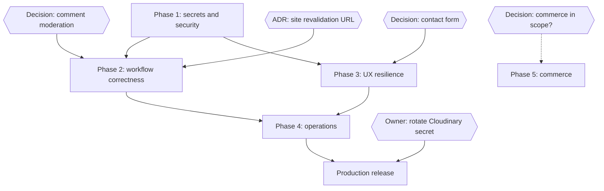

# Dependency Map

## External dependencies

| Dependency                          | Needed for                                    | Status                        |
| ----------------------------------- | --------------------------------------------- | ----------------------------- |
| Cloudinary console access           | SEC-0 rotation                                | Owner                         |
| Production hosting, domains, HTTPS  | Revalidation wiring test, deploy verification | Not available in this session |
| Email provider (optional)           | Contact form via email, newsletter sending    | Only if chosen                |
| Payment provider + merchant account | Phase 5                                       | Only if commerce is in scope  |

## Internal ordering constraints

- The revalidation wiring (Phase 2) depends on the Phase 1 webhook contract.
- E2E in CI (Phase 4) depends on Phase 3 boundaries so failures render
  predictably.
- The `post_comments` composite FK (DB-1) must ship before any change of the
  moderation default, so both land in reviewed migrations in order.
